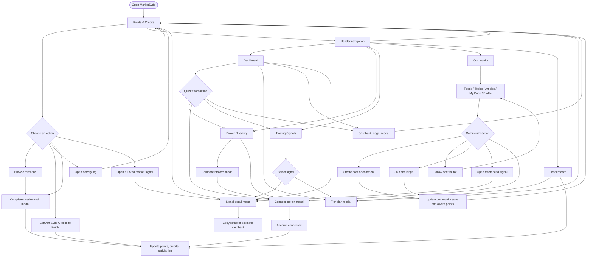

# MarketSyde

MarketSyde is a trader rewards dashboard combining broker rebates, market signals, community features, and points-based progression.

## UX Flow



## Primary Views

- **Points & Credits:** missions, credit conversion, activity history, and reward progression.
- **Dashboard:** quick-start onboarding, performance, broker highlights, signals, and cashback access.
- **Broker Directory:** filter partners, compare rebate conditions, and connect a trading account.
- **Trading Signals:** filter and inspect market setups, with tier-gated upgrade prompts.
- **Community:** browse feeds, topics, articles, profiles, challenges, and trader discussions.
- **Leaderboard:** view rankings and earn additional points.

## Development

```bash
npm install
npm run dev
```

### Journal views (v2.28.0)

The journal opens in **Easy** for new preferences. Use **View** to choose Easy,
Standard, or the original Advanced interface independently for each supported tab. Use a
card's **⋯** menu to hide it, read more detail, or move it; **+ Add card** restores
hidden cards and reveals extra tools. Customized layouts are labeled **Custom**.
Profile → About You → **Journal view** controls the default, per-tab levels, and
reset. Resetting views never changes trades.

**Trade Log keeps its original interface**, including its shared header, eight
KPI cards, filters, grouping, columns, bulk actions, replay, exports, pagination,
and full review drawer. It is not affected by the journal view level or card
customizations. The simplified "My trades", manual-entry, and Quick review
interfaces from v2.27.0 have been withdrawn. Saved trades and review notes are
retained; no journal records are reset.

Preferences are versioned in the existing browser-local journal storage, with
in-memory fallback and a visible warning if storage is unavailable or unreadable.
This static Vite application has no preferences API or server database; views are
not synced between devices. The existing journal demo-date basis is retained.
Overview, Playbook, Backtest, and AI Coach retain their existing content behind
the shared view/card foundation. Their dedicated simplification and the optional
audit fixes remain deferred.

### Simple Insights

Insights defaults to a ready-to-read report with six KPI cards and trends, a
trading calendar with weekly totals, a cumulative realized P&L / drawdown curve,
closing-weekday bars, entry-hour bars, an entry day/hour heatmap, and rule-based
observations. Every chart supports exact-value hover/focus details and opens the
same trade drawer. Drawer links open the original Trade Log and full review.
The curve supports drag-to-zoom and double-click/Escape reset; chart interactions
do not change the report filters.

Only three report filters are shown: **7D / 30D / 90D / YTD / All** (30D by
default), **Account** (hidden for a single account), and **All / Long / Short**.
Selections are stored as `insightsRange`, `insightsAccount`, and `insightsSide`
query parameters, with `insightsAsOf` anchoring the final calendar date.
`journalTab=insights` opens the report directly; `journalTab=entries&journalTrade=ID`
opens a linked saved trade. Reload and browser Back/Forward restore selections.
URLs share selections, not private trade records; the receiving browser uses its
own saved journal and reporting profile.

Profile → Profile → **Journal reporting** sets the timezone and reporting currency.
The browser timezone and existing journal currency are the defaults. Calendar,
weekday, period boundaries, and curve use **local exit dates**; hourly and heatmap
views use **local entry times**, including daylight-saving changes. Other
currencies are visibly excluded rather than added without exchange rates.
Closed trades without a valid exit timestamp or reported result are excluded
with a coverage notice. Missing entry times exclude only entry-time analytics.
Results deduct recorded costs; missing costs are disclosed, not inferred. This
explicit recorded-cost basis can include trades that Advanced excludes when
total costs are unknown.

KPI comparisons use the immediately preceding equal number of calendar days;
an empty previous period is labeled, not treated as a measured zero. Observations
require at least five trades in every compared group. Widgets can be hidden or
reordered through the existing card controls. Choose **Advanced** for Insights in
Profile's **Journal view** section to retain the original reports and tools.

Focused journal regression checks:

```powershell
node --import tsx --test src\components\journal\tests\simple-insights.test.ts src\components\journal\tests\journal-views.test.ts src\components\journal\tests\journal.test.ts src\components\journal\tests\day-review.test.ts
```